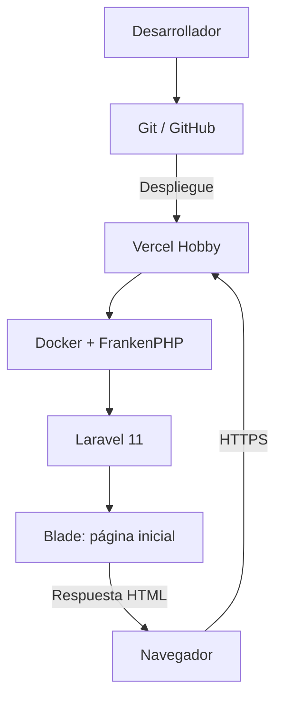

Programa de Lealtad para Tienda en Línea

Prueba técnica de desarrollo de una aplicación web para la administración de un programa de fidelización de clientes.

1. Descripción del proyecto

El objetivo del proyecto es crear un sistema de lealtad que usara una tienda en linea, donde cada cliente puede acumular puntos por sus compras, tener nivel de fidelidad y con esos puntos canjear recompensas varias.

El sistema tendria dos apartados:

1.- Un panel administrativo la cual estara destinado al personal que controla la tienda, teniendo un administrador de usuarios, roles y permisos, consultar a los clientes y tener un modulo de supervisacion del programa de laaltad.

2- El otro seria el portal del cliente, la cual puede consultar sus puntos, que nivel tiene de fidelidad y sus recompensas que tiene disponible y las que puede tener, un historial practicamente de puntos.

Todo esto usaremos una api llamada fakeapi.dev, nos dara los datos de prueba que necesitamos para este proyecto.

2. Tecnologías utilizadas

Backend

1.- PHP: lenguaje de programación del servidor.
2.- Laravel 11: framework principal para desarrollar la lógica de negocio, controladores, modelos, validaciones y endpoints.
3.- Composer: administración de dependencias PHP.

Frontend previsto
1.- Blade: motor de plantillas de Laravel.
2.- Bootstrap: diseño responsivo de las interfaces.
3.- jQuery: interacciones del lado del cliente.
4.- AJAX: comunicación asíncrona entre las interfaces y el backend.

Infraestructura
1.- Git y GitHub: control de versiones y almacenamiento del código fuente.
2.- Vercel Hobby: plataforma de despliegue de la aplicación.
3.- Docker: configuración del entorno de ejecución.
4.- FrankenPHP: servidor de aplicaciones PHP para ejecutar Laravel en Vercel.
Nota: La base de datos y el almacenamiento de imágenes se definirán e incorporarán en las siguientes etapas.

3.  Arquitectura del sistema

En esta etapa el codigo se administra en GitHub y se despliega en vercel, ahi laravel se ejecuta mediante un contenedor Docker apoyado con FrankenPHP.

Siguiendo la linea de desarrollo me permitira crear localmente mis modulos, cuando este listo y probado lo subo a git y de ahi a vercel.

Aqui en este punto de desarrollo aun no e probado la conexion de bd.

4.-  Decisiones técnicas

Eleji laravel por que es el framework que mas conosco y trabajo mejor, en las peticiones del documento de desarrollo decia que era libre a elegir, y como no hay mucho tiempo, prefiero realizarlo con lo que conozco, pero si un dado caso requieran otro lenjuage no tengo ningun inconveniente en aprenderlo.

5.- Despliegue en producción

La aplicación se encuentra publicada en:

https://prueba-tecnica-ebon-six.vercel.app

En este punto solo se visualiza correctamente la pagina de bienvenida de laravel.

para que pudiera hacer esto tuve que relacionar unos archivos para que vercel y docker pudieran identificarlo bien.

El proyecto utiliza los siguientes archivos para que funcione:

1.- Dockerfile.vercel: configuración del contenedor y dependencias PHP.
2.- Caddyfile: configuración del servidor FrankenPHP.
3.- vercel.json: configuración de servicios y enrutamiento de Vercel.
4.- .dockerignore: exclusión de archivos innecesarios o privados durante la construcción de la imagen.
5.- Las variables de producción se administran desde Vercel y no se almacenan directamente en el repositorio.

6.- Estado del proyecto

Se completo los roles y permisos junto con los usuarios para crearlos, actualizarlos, eliminarlos, etc.
Se incluye la parte de sincronizacion de datos del fakeapi.

7.- Como se instala en local

Pasos para instalar el sistema

    1.-composer install
    2.-El proyecto esta usando como BD MySql
        php artisan migrate --seed
    3.-en el env agregar sus respectivas llaves
        Para fakeAPI
        FAKEAPI_BASE_URL
        FAKEAPI_API_KEY

        Para el SMTP
        MAIL_MAILER
        MAIL_SCHEME
        MAIL_HOST
        MAIL_PORT
        MAIL_USERNAME
        MAIL_PASSWORD
        MAIL_FROM_ADDRESS
        MAIL_FROM_NAME

        Para crear un super root usar estos parametros en el env
        SUPER_ROOT_EMAIL
        SUPER_ROOT_PASSWORD 
